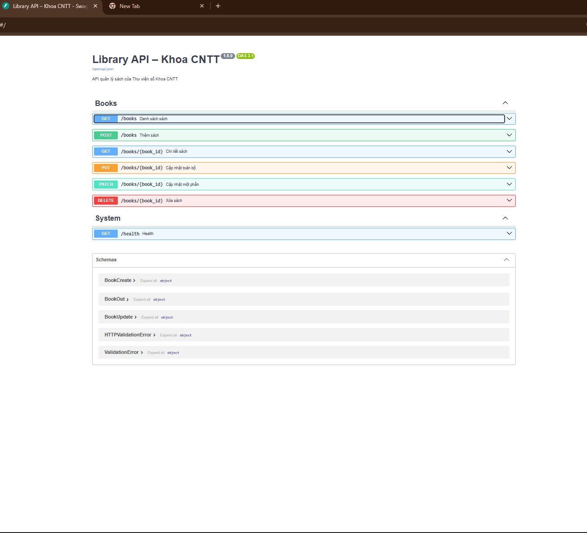
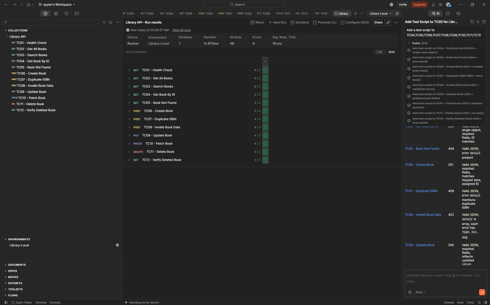

# LIBRARY API - QUẢN LÝ THƯ VIỆN SỐ

## 1. Giới thiệu

Dự án xây dựng Web API quản lý sách thư viện
bằng Python và FastAPI.

API hỗ trợ đầy đủ các chức năng CRUD:

- Xem danh sách sách.
- Tìm kiếm theo tên và tác giả.
- Xem chi tiết sách.
- Thêm sách.
- Cập nhật sách.
- Xóa sách.

## 2. Công nghệ sử dụng

- Python 3.10+
- FastAPI
- Pydantic
- Uvicorn
- Postman
- Git
- GitHub
- Ubuntu WSL2

## 3. Cài đặt

Tạo môi trường ảo:

```bash
python3 -m venv .venv
```

Kích hoạt môi trường:

```bash
source .venv/bin/activate
```

Cài thư viện:

```bash
pip install -r requirements.txt
```

## 4. Chạy chương trình

```bash
uvicorn app.main:app --reload
```

Truy cập Swagger:

http://127.0.0.1:8000/docs

## 5. Danh sách API

| Method | Endpoint | Chức năng |
|---|---|---|
| GET | /health | Kiểm tra server |
| GET | /books | Danh sách sách |
| GET | /books/{id} | Chi tiết sách |
| POST | /books | Thêm sách |
| PUT | /books/{id} | Cập nhật toàn bộ |
| PATCH | /books/{id} | Cập nhật một phần |
| DELETE | /books/{id} | Xóa sách |

## 6. Kiểm thử

Sử dụng Postman để kiểm thử API.

Bộ kiểm thử gồm 12 test case từ TC01 đến TC12.

Import các file trong thư mục postman/.

Chọn environment Library-Local.

Chạy Collection Runner theo thứ tự TC01-TC12.

## 7. Minh chứng Swagger



## 8. Minh chứng Postman



## 9. GitHub

Dự án được quản lý bằng Git.

Nhánh chính: main

Nhánh thực hiện: feature/books-api

Sử dụng Pull Request để đưa thay đổi vào main.
